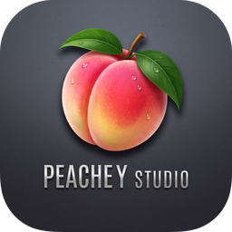

<p align="center">
  
</p>

<h1 align="center">Peachey Studio</h1>

<p align="center">
  A pattern-based music workstation for macOS, Windows and Linux.<br>
  Native Rust, free and open source.
</p>

<p align="center">
  <a href="https://github.com/hacchake/peachey-studio/actions/workflows/ci.yml"></a>
  <a href="LICENSE"></a>
</p>

> Peachey Studio is a fork of [Peel Studio](https://github.com/Vheissu/peel-studio)
> by Dwayne Charrington, distributed under the same GPL-3.0-or-later license.
> It is maintained separately and isn't endorsed by the Peel Studio project.


Build a beat or a melody as a pattern, paint it into an arrangement, then
change the pattern once and every copy follows. Peachey Studio ships with
recorded drums, guitars and bass, synths, an 808 that slides, a full mixer
and four finished demo songs to pull apart.

It's native Rust from the interface to the audio engine: `wgpu` drawing
on Metal, D3D12 or Vulkan, and a lock-free realtime engine. There is no
web view.

> [!NOTE]
> Peachey Studio is in early development. The core editors, engine, devices
> and file format work today. [docs/ROADMAP.md](docs/ROADMAP.md) tracks
> what's next. Expect rough edges, and please report them.

## Screenshots

| Piano Roll | Mixer |
| --- | --- |
|  |  |
| **Channel Rack** | **Performance** |
|  |  |
| **EQ** | **Instrument editor** |
|  |  |

## Features

- **Patterns.** A Channel Rack step sequencer and a Piano Roll edit the
  same notes. Pattern clips in the Playlist stay linked until you make one
  unique.
- **21 instruments.** A recorded acoustic kit, recorded guitars and bass,
  synthesized drums, a tuned 808, Poly and Cross synths, electric and
  acoustic pianos, mallets, violin, zither, saxophone and a sampler.
- **21 effects.** EQ, compressor, multiband, limiter, delay, reverb,
  distortion, filter, modulation, Tape, Gate, Glitch, Crush and a
  mastering chain. Over 380 factory presets across instruments and
  effects, and CLAP and VST3 plugins load alongside them. On Windows a
  VST3 plugin's own window opens from its device panel.
- **Arrangement.** Pattern, audio and automation clips, fades, slicing,
  markers, tempo changes and ramps, alternate arrangements, and audio
  loops that follow the tempo.
- **Mixing.** Console strips with inserts, buses, post-fader sends,
  sidechain compression, gain reduction meters and curved automation of
  any parameter.
- **Performance.** Launch clips by lane and scene on the next bar and
  record the performance as a new arrangement.
- **Note tools.** Legato, chop, arpeggiate, strum, flam, humanize and
  more, previewed live before they apply.
- **Recording.** Computer keyboard and MIDI keyboards (with MPE), note
  recording, and audio recording onto armed lanes with input monitoring.
- **Files.** Open project format with atomic saves, autosave and crash
  recovery. MIDI import and export. WAV, MP3, FLAC and AIFF export of the
  mix or stems.
- **Scripting and agents.** JavaScript, Lua and Python actions, a headless
  renderer, and an MCP server so AI agents can compose, mix and export.
- **Accessibility.** Screen reader support through AccessKit and keyboard
  focus traversal.

Timing uses exact rational musical time, so playback is sample-accurate
and can't drift, and tests verify that the realtime audio path never
allocates.

## Download

There are no packaged releases yet. When there are, builds for macOS
(Apple silicon), Windows and Linux will be on the
[releases page](https://github.com/hacchake/peachey-studio/releases). Until
then, build from source.

## Build from source

Install Rust with [`rustup`](https://rustup.rs). The toolchain is pinned in
`rust-toolchain.toml` and installs itself on first build. You also need a
C compiler for the bundled MP3 encoder (Xcode Command Line Tools, Visual
Studio Build Tools, or GCC/Clang). On Linux, install the ALSA headers
(`libasound2-dev` on Debian and Ubuntu) and a Vulkan driver.

```sh
cargo run --release            # the app
cargo run -p peel-cli -- help  # headless tools
cargo test --workspace
```

`scripts/package-macos.sh` builds an app bundle and disk image in
`dist/`. Set `SIGN_ID` to a Developer ID identity to sign it; otherwise
it's ad-hoc signed for local use.

## Headless tools

The `peel` command renders, inspects and validates projects without a
window:

```sh
peel render song.peelproj mix.wav --rate 48000 --bits 24
peel render song.peelproj mix.mp3 --bitrate 192 --normalize
peel render "--demo=Night Shift" night.wav
peel render song.peelproj drums.wav --solo "Drum Bus" --dry-master
peel songs                        # demo songs and song starters
peel devices                      # every native instrument and effect
peel audition peel.bass.808 808.wav --key 33
```

Run `peel help` for every option.

## Documentation

| Guide | Covers |
| --- | --- |
| [Guide](docs/GUIDE.md) | Projects, templates, kits, the 808, presets, clip editing, export |
| [Audio tools](docs/AUDIO_TOOLS.md) | Mixing, EQ, mastering, instruments, MIDI and recording |
| [Scripting](docs/SCRIPTING.md) | JavaScript, Lua and Python actions and their API |
| [MCP](docs/MCP.md) | Connecting AI agents to a live or headless session |
| [Architecture](docs/ARCHITECTURE.md) | How the crates fit together |
| [Realtime rules](docs/REALTIME.md) | What may and may not run on the audio thread |
| [Design](docs/DESIGN.md) | The visual system |
| [Roadmap](docs/ROADMAP.md) | What's done and what's next |
| [Specification](docs/SPEC.md) | The full product specification |

## Contributing

Bug reports and pull requests are welcome. Read
[CONTRIBUTING.md](CONTRIBUTING.md) first, and report security problems
privately as described in [SECURITY.md](SECURITY.md).

## License

Peachey Studio is licensed under [GPL-3.0-or-later](LICENSE). It is based on
[Peel Studio](https://github.com/Vheissu/peel-studio), copyright its
contributors; the original copyright notices are kept in the source.

MP3 encoding statically links LAME through `mp3lame-encoder` and
`mp3lame-sys` (LGPL-3.0); FLAC encoding uses `flacenc` (Apache-2.0). Bundled fonts, icons and recordings keep their own
licenses, listed in [assets/LICENSES.md](assets/LICENSES.md). The
palm-muted guitar recordings are CC BY 4.0: if you publish audio that uses
them, credit them as described in
[their notice](assets/strings/palm-muted/README.md).

VST is a registered trademark of Steinberg Media Technologies GmbH.
VST3 hosting uses the [`vst3`](https://crates.io/crates/vst3) bindings
(MIT or Apache-2.0).

Peachey Studio is an independent project. It isn't affiliated with or
endorsed by Image-Line, and it doesn't use FL Studio code, artwork, presets
or samples.
